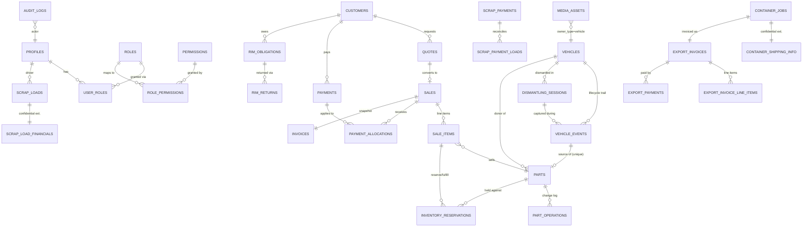

# LAL Motors — Production Database Schema Blueprint

Status: **PROPOSED — NOT YET APPLIED TO ANY DATABASE.** This document, `supabase/migrations/0001_initial_schema.sql`, and `supabase/seed.sql` are a review package only. Nothing here has been run against Supabase.

**Revision note (this pass):** this is a correction pass over a reviewed-and-rejected first draft. The reviewer found the first draft's RLS model too broad (navigation-hiding mistaken for authorization), a role-assignment privilege-escalation path, an untrusted audit-log insert path, unrestricted media-metadata writes, a too-simple payments model, and no explicit Draft/Reserve/Fulfill stock model. All of those are fixed below. The reviewer also asked for a Suppliers/Purchase-Orders domain if the frontend has one — it does not (Section 5 documents the search), so none was added.

Source of truth for this design: the **current, frozen** `new-production` frontend (post Yard-removal, post "Dismantling Employee App" + Quick Part Capture consolidation, commit `7cd5fcb`), cross-checked against the legacy Cloudflare D1/Drizzle backend for business rules worth preserving, and against `src/lib/nav.ts` specifically for the real role→screen access matrix (Section 10). Where the frontend and legacy disagree, the current frontend wins — legacy is reference only. Two exceptions, explicitly directed by the reviewer this pass: the payments lifecycle (Section 6.6b) and the Draft/Reserve/Fulfill stock model (Section 7) are designed for correctness even though the current simplified POS mock doesn't yet exercise every state — documented as such, not presented as "what the frontend already does."

---

## 1. Architecture Summary

One PostgreSQL database (Supabase), organized into 9 schema domains, all living in the `public` schema except Supabase's own `auth` schema:

1. **Identity & Access** — `profiles`, `roles`, `permissions`, `role_permissions`, `user_roles`, `user_invites` + RBAC helper functions, including the domain-scoped staff helpers introduced this pass (Section 9).
2. **Media** — one polymorphic `media_assets` table, gated by a single `can_access_media()` domain/ownership function (Section 9.4) — not a blanket authenticated policy.
3. **Audit** — one append-only `audit_logs` table, written ONLY through `write_audit_log()` (Section 9.3) — no direct client insert path.
4. **Vehicles** — `vehicles`, `carriers`, `vehicle_events`, `dismantling_sessions`, `vehicle_intake_batches`/`vehicle_intake_items`, `vehicle_completions`.
5. **Parts** — `parts`, `part_operations`.
6. **Customers & Sales** — `customers`, `quotes`/`quote_items`, `sales`/`sale_items`, `inventory_reservations` (new, Section 7), `payments`/`payment_allocations` (redesigned, Section 6), `invoices`, `returns`, `sales_settings`.
7. **Scrap & Tire/Rim** — `scrap_loads`/`scrap_load_financials`, `scrap_payments`, `scrap_payment_loads`, `driver_check_submissions`, `rim_obligations`/`rim_returns`, `daily_closes`.
8. **Containers / Export** — `container_jobs`/`container_shipping_info`, `consignees`, `container_events`, `export_invoices`/`export_invoice_line_items`/`export_invoice_revisions`, `export_payments`.
9. **Cross-cutting** — `idempotency_keys`.

Core design rule enforced throughout: **one connected relational system** — one vehicle master, one customer master, one person identity (roles layered via `user_roles`), one part identity, one container record, one media architecture, one audit architecture, one payment architecture (allocatable across sales, not sale-coupled).

Design priorities, in order: correctness and auditability of money/evidence → **real authorization boundaries** (not navigation hiding) → confidentiality boundaries (export) → query performance at scale → extensibility for the deferred RPC layer → schema simplicity.

---

## 2. Entity Map (Master Entities)

| Master entity | Table | Never duplicated as |
|---|---|---|
| Vehicle | `vehicles` | A second "auction vehicle" / "receiving vehicle" / "dispatch vehicle" / "dismantling vehicle" row |
| Person / staff identity | `profiles` (1:1 with `auth.users`) | A second employee/user table per role |
| Part | `parts` | A separate "dismantling part" vs. "inventory part" table |
| Customer | `customers` | A separate tire-shop/rim customer table |
| Container | `container_jobs` | A separate Export-side container table |
| Media/file | `media_assets` | A per-domain photo/document join table |
| Audit event | `audit_logs` | A per-domain audit table |
| Payment | `payments` (+ `payment_allocations`) | A payment column glued directly onto one sale |

No Supplier/Vendor/Purchase-Order master entity exists — see Section 5.

---

## 3. Mock-Data Duplication Collapsed

- **`completionQueue` + `yardCorrections`** → one `vehicle_completions` table with a `decision` column.
- **Dismantling `vehicle_events` (PART_REMOVED) + approved parts** → one `parts` table, idempotently derived via `parts.source_vehicle_event_id` (unique).
- **Scrap driver-visible fields + manager-only weight/rate/amount** → split into `scrap_loads` (driver-safe) and `scrap_load_financials` (office-only, 1:1), now additionally enforced by `is_scrap_office()` rather than a blanket policy.
- **Container Loading's loader-safe view + the full Export record** → split into `container_jobs` (operational, gated by `is_container_staff()`) and `container_shipping_info` (confidential, gated by `is_export_authorized()`).
- **A sale's payment, previously one row hard-coupled to one sale** → `payments` (customer-level, with a pending/posted/void lifecycle) + `payment_allocations` (how a payment's amount spreads across one or more sales) — see Section 6.
- **A line's "is this held or sold" state, previously only `parts.operational_status`** → `sale_items.stock_action` + `inventory_reservations` (quantity-aware, traceable to the specific sale/line) — see Section 7.
- **Rim obligation "owed" + a derived balance** — kept as **derived** (`owed - sum(returns)`), never a stored mutable counter.
- **Team member list** — decomposed into `profiles` + `user_roles` + derived aggregates, never a denormalized array.

---

## 4. Domain Relationships (narrative)

Unchanged from the first draft for Vehicles → Dismantling → Parts → donor vehicle, and for Scrap/Container flows. The Customers & Sales chain is revised:

A `customer` accumulates `quotes` → (optionally) `sales`. A `sales` row carries `sale_items`, each with a `stock_action` (`none`/`reserve`/`fulfill`); a `reserve` or `fulfill` line gets an `inventory_reservations` row. Separately, `payments` (customer-level, not sale-level) exist in `pending`/`posted`/`void` status; a `payment_allocations` row says how much of a payment applies to which `sales` row. **Only a posted allocation affects `sales.amount_paid`/`balance_due`/`payment_status`.** A finalized `sale` gets exactly one immutable `invoices` snapshot. The same `customers` row is reused for `rim_obligations` — no second customer dataset.

### Mermaid ER Diagram



---

## 5. Suppliers / Purchase Orders — Finding: does not exist, not added

Per the reviewer's explicit instruction to re-check for this domain before adding it, a repository-wide, case-insensitive search was run across `src/` (all `.ts`/`.tsx`), the legacy reference backend, `git log --all`, and this blueprint's own prior draft, for: `supplier`, `vendor`, `purchase order`, `purchase_order`, `PO`. Result: **zero matches** for any supplier/vendor/purchase-order concept anywhere in the current frontend or its history. The only superficially-related hit was the unrelated English word "vendor's" inside this blueprint's own prose (not a feature reference).

The closest existing concept is **per-vehicle auction purchase accounting**, already modeled and already present in `vehicles`: `purchase_price`, `auction_fees`, `transportation_cost`, `total_landed_cost` (generated), `invoice_amount`, `balance_due`, and the free-text `auction_source` (e.g. "Copart", "IAA", "Manheim" — confirmed in `src/lib/mock/vehicles.ts`). This is a per-vehicle invoice/balance pair, not a normalized supplier ledger with its own payment-posting workflow — there is no "Supplier" entity with its own identity, no PO document separate from the vehicle record, no PO line items, and no "Record Supplier Payment" action anywhere in the UI.

**Decision: no `suppliers`/`purchase_orders`/`purchase_order_items`/`supplier_payments` tables were added.** Per the explicit instruction not to invent functionality the frontend doesn't have, `vehicles.invoice_amount`/`balance_due` are left exactly as they already were in the first draft. If a real Suppliers/PO workflow is built into the frontend later, it should become its own domain at that time, modeled the same way `payments`/`payment_allocations` are modeled here (Section 6) rather than retrofitted onto `vehicles`.

---

## 6. Payments — Redesigned (pending → posted / void, allocation-based)

**Problem with the first draft**: `payments.sale_id not null` coupled a payment to exactly one sale with no lifecycle — a payment existed and immediately counted, with no "has this actually cleared/been confirmed" state, and no way to represent a deposit covering more than one sale (or a sale paid across more than one payment, which the schema did technically allow via multiple rows, but with no posting gate at all).

**New design**:

- **`payments`** is now customer-level, not sale-level: `customer_id not null`, no `sale_id` column at all. `status text check (status in ('pending','posted','void'))`, default `'pending'`. `posted_at`/`posted_by`, `voided_at`/`voided_by`/`void_reason` (CHECK: a `void` row must carry a reason). `client_request_id` (unique-when-present) for idempotent POS retry.
- **`payment_allocations`** (new table) says how a payment's amount applies to one or more `sales` rows: `payment_id`, `sale_id`, `amount`. A payment can have zero allocations (unapplied credit), one (the common case), or several (split across sales).
- **Critical rule, enforced architecturally, not just by convention — and corrected this pass to actually be enforced, not just documented**: `sales.amount_paid`/`balance_due`/`payment_status`/`fulfillment_status` are now protected by an explicit **column-level `REVOKE UPDATE (...) ... FROM authenticated`** on `sales` — not merely a comment. `payments` has select+insert-only RLS (no update/delete policy). `payment_allocations` has **select-only** RLS — there is no insert policy for direct clients at all; creating an allocation requires validating "allocation total ≤ payment amount," "sale belongs to the same customer as the payment," and "sale is not over-allocated," none of which RLS or a CHECK constraint can express (it needs aggregating sibling rows and cross-referencing two other tables), so it is entirely deferred to `allocate_payment()`/`post_payment()` (`SECURITY DEFINER`, bypasses RLS). Together these mean the `pending → posted`/`→ void` transition, and any direct edit of the four protected `sales` columns, **cannot** happen via a direct client request under any role, including Owner — only inside a `SECURITY DEFINER` RPC.
- **Financial correction**: a posted payment is never edited or deleted. A reversal/correction is a new payment or a new allocation row, or a `void` (with `void_reason`) on the original — consistent with the `export_payments.correction_of` pattern and, as of this pass, `scrap_payments.correction_of`/`correction_reason` (added this pass — see Section 8).

**Workflow this supports** (`Create Payment → Allocate → Post Payment → balance changes`): insert a `payments` row (`pending`, direct client) → `allocate_payment()` RPC validates and inserts one or more `payment_allocations` rows (no balance effect yet) → `post_payment()` RPC atomically sets `status = 'posted'`, `posted_at`/`posted_by`, and updates every allocated sale's `amount_paid`/`balance_due`/`payment_status`. Neither RPC is implemented in this migration, per instruction — only the table shape, the column-level REVOKE, and the removed insert policy that make a direct-client bypass impossible.

---

## 7. Draft / Reserve / Fulfill — Stock Handling

**Problem with the first draft**: the only stock-state signal was `parts.operational_status` (`AVAILABLE`/`RESERVED`/.../`SOLD`), a single enum with no quantity awareness, no link back to *which* sale/line is holding it, and in practice (confirmed by grep) never actually mutated anywhere in the current frontend code — it exists only as a static display value today.

**New design**:

- **`sale_items.stock_action`** (`none`/`reserve`/`fulfill`, default `none`) — the per-line choice. `none` is for manual/service lines with no inventory effect (e.g. "shop labor"). A **Draft** quote/sale simply has no lines with `stock_action` set yet (or the sale/quote hasn't been created) — Draft is represented by the existing `quotes.status = 'DRAFT'`, not a new column.
- **`inventory_reservations`** (new table) — `part_id`, `sale_id`, `sale_item_id`, `quantity`, `status` (`active`/`fulfilled`/`released`/`expired`), `reserved_at`/`expires_at`/`released_at`/`fulfilled_at`. A **partial unique index** on `(sale_item_id) where status = 'active'` means one line has at most one live reservation at a time. This is quantity-aware (not a boolean) and traceable to the exact sale line, so "how much of this part is currently reserved" is a real, indexed query (`inventory_reservations_part_active_idx`), not an inference from a single status flag.
- **No direct-client CRUD at all — corrected this pass.** The first-pass RLS still let any sales/parts staff member insert/update/delete `inventory_reservations` directly. That policy is removed; only a `select` policy remains. Reserve/fulfill/release are now exclusively `reserve_stock()`/`fulfill_sales_order()`/`release_reservation()` (deferred, `SECURITY DEFINER`) responsibilities.
- **Relational integrity, enforced, not just hoped for.** Three independent FKs (`part_id`, `sale_id`, `sale_item_id`) can't stop someone from inserting a row where those three ids don't actually agree with each other (a valid-but-unrelated combination). A new `before insert or update` trigger, `check_reservation_integrity()`, looks up the real `part_id`/`sale_id` for the given `sale_item_id` and rejects the row if either supplied value disagrees — this fires for **every** writer, including a future RPC, since triggers aren't bypassed by `SECURITY DEFINER` or RLS.
- **`sales.fulfillment_status`** (`unfulfilled`/`partial`/`fulfilled`) — a small rollup summary, maintained by the deferred RPCs, not computed live on every read (same tradeoff already made for `payment_status`), and now additionally protected by the same column-level `REVOKE` as `payment_status` (Section 6).
- **Overselling / race conditions**: explicitly a concurrency problem no RLS policy or CHECK constraint can solve — "available to sell" is `parts.quantity − sum(active reservations for that part)`, which must be computed and acted on inside a single transaction with row-level locking (`select ... for update` on the `parts` row) inside the deferred RPCs. This migration provides the table shape and the integrity trigger only; the locking strategy is documented here, not implemented, per instruction.

**Deferred RPCs this enables** (named only, not implemented): `reserve_stock(sale_item_id, quantity)`, `fulfill_sales_order(sale_id)` (walks every `reserve`/`fulfill` line, locks each part, consumes quantity, flips `inventory_reservations.status`, updates `parts.quantity`/`operational_status`, updates `sales.fulfillment_status`), `release_reservation(reservation_id, reason)`.

**Zero-quantity inventory**: unaffected and reconfirmed — `parts.quantity int not null default 1 check (quantity >= 0)` already permits `0`; a sold-out part is never deleted or hidden, only rendered as "Out of Stock" by the query layer. No schema change was needed for this; a clarifying comment was added to the column in the migration. The seed data now demonstrates this concretely: the Alternator part consumed by the completed Sale 1 example ends the seed file at `quantity = 0`, `operational_status = 'SOLD'`, still present and selectable as a row — never deleted.

### 7a. Dismantling review outcomes (approved / rejected / duplicate / pending)

Added this pass, directly on `parts.status` — **not a second parts dataset**: the CHECK is extended from `('captured','draft_ready','manager_review','approved')` to additionally allow `'rejected'` and `'duplicate'`. "Keep for later / pending" needs no new value — staying in `'manager_review'` already means exactly that. A new nullable `duplicate_of_part_id uuid references parts(id)` records which approved part a `'duplicate'`-outcome capture duplicates. A CHECK constraint, `parts_rejected_duplicate_not_sellable_chk`, guarantees a rejected/duplicate row can never reach `stage = 'ready_for_sale'` or `operational_status = 'AVAILABLE'` — a database-enforced guarantee, not an application convention, that these records stay historical and never become sellable inventory. The `check_parts_mutation_authorization` trigger (Section 9.5) additionally guarantees only a reviewer can set any of these three outcomes in the first place.

---

## 8. Financial Correction Model — Consistency Across Domains

All money-bearing/finalization domains now follow the identical rule — correction = a new row, never an edit — but via **two different enforcement mechanisms** depending on what RLS can and can't express:

| Domain | Table | Correction mechanism | Enforced by |
|---|---|---|---|
| Customer sales | `payments` / `payment_allocations` | `status = 'void'` + `void_reason` (never delete); a reversal is a new offsetting allocation/payment | RLS (no update/delete policy on either table) |
| Scrap | `scrap_payments` | **Corrected this pass**: added `correction_of` self-FK + `correction_reason` (same shape as `export_payments`, replacing the first draft's `discrepancy_reason`-only approach, which still allowed a direct `UPDATE`). `discrepancy_reason`/`discrepancy_approved_by` remain for discrepancies known at insert time. | RLS — the `scrap_payments_office_update` policy is **removed**; select+insert only remains |
| Export | `export_payments` | `correction_of` self-FK + `correction_reason` (unchanged) | RLS (no update/delete policy) |
| Export invoicing | `export_invoices` / `export_invoice_revisions` | A Finalized invoice is immutable; a correction is a new `export_invoice_revisions` row | **Corrected this pass**: a trigger (`check_export_invoice_immutability`), not RLS — Draft/Review invoices must stay directly editable by export-authorized users, which an RLS update/delete removal would have blocked entirely. The trigger instead blocks the update **only once `status = 'Finalized'`**, which RLS cannot conditionally express. A matching trigger on `export_invoice_line_items` blocks insert/update/delete once the parent invoice is Finalized. |

No posted/finalized financial record in this schema can be edited or deleted through the paths audited above — either because the operation has no RLS policy permitting it at all, or because a trigger rejects it once the record reaches its immutable state, regardless of who is asking (including a future `SECURITY DEFINER` RPC — triggers are not bypassed by `SECURITY DEFINER` or RLS).

---

## 9. RBAC — Privilege-Escalation Fix and Domain-Scoped Helpers

### 9.1 `is_owner()` vs. `is_admin()`

**Problem with the first draft**: `is_admin()` (owner OR engineer_admin) gated `user_roles` writes, `user_invites`, and `profiles` updates. That means Engineer Admin could assign roles — including granting itself or anyone else the Owner role, disabling/removing any account, or managing invites — none of which `nav.ts` actually gives Engineer Admin a screen for (only Owner has a "Users & Activity" / Team nav entry).

**Fix**: added `is_owner()` = `has_role('owner')` only. `profiles` UPDATE, `user_roles` write (all operations), and `user_invites` (all operations) now gate on `is_owner()`, not `is_admin()`. Read access to these tables stays `is_admin()` (viewing is not an escalation risk) or self-access. Engineer Admin retains **full operational** access to every operational domain below — it only loses the ability to touch account/role administration itself.

### 9.2 Domain-scoped staff helpers (replacing blanket `authenticated` policies)

Each helper's role set was read directly off `src/lib/nav.ts` — the actual role→screen routing table in the current frontend — not guessed:

| Helper | Role set | Governs |
|---|---|---|
| `is_vehicle_domain_staff()` | owner, engineer_admin, manager, auction, receiving, dismantling | `vehicles`, `carriers`, `vehicle_events`, `vehicle_intake_*`, `vehicle_completions` |
| `is_dismantling_staff()` | owner, engineer_admin, manager, dismantling | `dismantling_sessions` |
| `is_parts_staff()` | owner, engineer_admin, manager, employee, dismantling | `parts`, `part_operations` |
| `is_sales_staff()` | owner, engineer_admin, manager | `customers`, `quotes`, `quote_items`, `sales`, `sale_items`, `payments`, `payment_allocations`, `invoices`, `returns`, `inventory_reservations` |
| `is_scrap_office()` | owner, engineer_admin, manager, auction | `scrap_load_financials`, `scrap_payments` (office side), `scrap_payment_loads`, `rim_obligations`/`rim_returns` (office side), `daily_closes` |
| `is_container_staff()` | owner, engineer_admin, export_manager, container_loading | `container_jobs`, `container_events` (operational layer only) |
| `is_export_authorized()` (pre-existing) | owner, engineer_admin, export_manager | `consignees`, `container_shipping_info`, `export_invoices`, `export_invoice_line_items`, `export_invoice_revisions`, `export_payments` |

A Scrap Driver, Container Loading Employee, Dismantling Employee, or Export Manager now fails every helper outside their own domain — they cannot directly query or mutate `vehicles`, `parts`, `customers`/`sales`, or each other's confidential tables through the Supabase client, which is the exact gap the review flagged. `scrap_loads`/`scrap_payments`/`driver_check_submissions`/`rim_obligations`/`rim_returns` additionally keep their own-records-or-office pattern (a driver sees/creates their own rows; `is_scrap_office()` sees everything).

Three lookup/reference tables intentionally keep a blanket `authenticated`-read policy, by deliberate choice, not oversight: `roles`, `permissions`, `role_permissions` (knowing a role key exists is not a confidentiality concern) and `sales_settings` (the single global tax-rate row).

### 9.3 Audit logs are now trusted system history

**Problem with the first draft**: `audit_logs` had an `insert with check (auth.role() = 'authenticated')` policy — any logged-in session could write an arbitrary, fabricated audit row. A second problem, found in THIS pass's own first implementation and fixed before it ever shipped: `write_audit_log()` originally took `p_actor_role` as a plain parameter — a caller-supplied role string nothing validated, meaning a buggy or malicious caller could claim to be `'owner'` regardless of their real roles.

**Fix, current state**: `audit_logs` has **only** a select policy (`is_admin()`) — no insert policy of any kind exists for ordinary clients. `public.write_audit_log(p_action, p_entity_type, p_entity_id, p_summary, p_changes, p_reason, p_request_id)` — note: **no `p_actor_role` parameter** — derives `actor_role` itself via `string_agg` over the caller's actual `public.user_roles` rows, the same source of truth every RLS policy already trusts. It remains a **trusted plumbing primitive, not a business RPC**: it makes no authorization decision of its own (the calling domain RPC must have already checked the caller may perform the underlying action) — it only guarantees the actor identity/role it records is real. **`EXECUTE` is explicitly revoked** from `public`, `anon`, and `authenticated` (see the SECURITY DEFINER PRIVILEGE AUDIT block in the migration, and Section 9.6 below) — a client cannot call `supabase.rpc('write_audit_log', ...)` directly; only a future `SECURITY DEFINER` domain RPC (which inherits `EXECUTE` via object ownership) or `service_role` can invoke it.

### 9.4 Media writes now respect domain/ownership, not "any authenticated user" — and now verify the owner actually exists

**Problem with the first draft**: `media_assets` had `insert with check (auth.role() = 'authenticated')` — a Scrap Driver could, via the Supabase client, attach a row claiming to be `owner_type = 'export_payment'` evidence, or read any other domain's media freely (the read policy only special-cased export-owned assets). A second gap, raised explicitly this pass: even a caller with legitimate domain access could attach a row whose `owner_id` is a random/nonexistent UUID, since `owner_id` is not and cannot be a single hard FK (Section 6.2 — it's polymorphic across 13 owner tables).

**Fix**: the select and insert policies on `media_assets` are gated by `public.can_access_media(owner_type, owner_id)` (authorization) **AND**, for insert, additionally `public.media_owner_exists(owner_type, owner_id)` (existence) — both must pass:

- `vehicle`/`vehicle_completion`/`vehicle_intake_batch` → `is_vehicle_domain_staff()`
- `dismantling_session` → `is_dismantling_staff()`
- `part` → `is_parts_staff()`
- `customer` → `is_sales_staff()`
- `rim_obligation`/`rim_return` → `is_scrap_office()` OR the caller holds `scrap_driver`
- `scrap_load`/`scrap_payment`/`driver_check` → `is_scrap_office()` OR an `EXISTS` check that the caller is the `driver_id` on the actual referenced row (a Scrap Driver can only attach/read evidence for **their own** load/payment/check, not any driver's)
- `container` → `is_container_staff()`
- `export_invoice`/`export_payment` → `is_export_authorized()`

`media_owner_exists()` (new this pass) runs a matching `EXISTS` check against the **real** owner table for every one of the 13 `owner_type` values — a random/nonexistent `owner_id` now fails the insert regardless of how legitimate the caller's domain access is.

### 9.5 Column/state authorization the first draft left as prose, now enforced by triggers

RLS is row-level — it cannot say "this role may update this row, except these three columns" or "except once this row reaches this status." The first draft described several such boundaries in comments only (parts pricing/location/SKU being reviewer-only, a loading employee's workflow ending at `ready_for_invoice`, a Finalized invoice being immutable) without actually enforcing them — any domain-staff role could, in fact, update any column via the broad `for all` policies that existed. This pass adds `BEFORE INSERT/UPDATE` trigger functions that enforce each boundary for real, regardless of RLS:

| Table | Trigger | Blocks for non-privileged roles |
|---|---|---|
| `vehicles` | `check_vehicles_mutation_authorization` | Changing `closed_reason`/`closed_note`/`assigned_id`, or setting `status` to `'Completed'`/`'Scrapped / Closed'` — for anyone who isn't owner/engineer_admin/manager. Auction/Receiving/Dismantling keep full access to their own routine workflow columns (VIN capture, receiving status, dismantling status, etc.) |
| `parts` | `check_parts_mutation_authorization` | Changing `price`/`core_charge`/`has_core_charge`/`sale_channels`/`stock_sku`/`location`/`zone`/`rack`/`shelf`/`bin`/`operational_status`/`stage`/`approved_by`/`approved_at`, or setting `status` to `'approved'`/`'rejected'`/`'duplicate'`, or touching a row already in one of those three terminal states — for anyone who isn't owner/engineer_admin/manager. Warehouse Employee/Dismantling keep INSERT (new capture) and basic pre-approval edits |
| `scrap_loads` | `check_scrap_load_status_authorization` | Setting `status` to `'approved'`/`'closed'`, or touching an already-`approved`/`closed` row — for anyone who isn't `is_scrap_office()`. A driver keeps their existing `new → ready_for_review` evidence workflow |
| `container_jobs` | `check_container_job_status_authorization` | Setting `status` to `'on_the_way'`/`'closed'`, or `closed_by`/`close_override_reason` — for anyone who isn't `is_export_authorized()` (deliberately **excludes** `container_loading`, which otherwise passes `is_container_staff()` for this same table's ordinary operational access) |
| `export_invoices` | `check_export_invoice_immutability` | Any update at all once `status = 'Finalized'` |
| `export_invoice_line_items` | `check_export_invoice_line_items_immutability` | Any insert/update/delete once the **parent** invoice is `'Finalized'` |
| `inventory_reservations` | `check_reservation_integrity` | Not a role check — rejects any row whose `part_id`/`sale_id` disagree with what `sale_item_id` actually belongs to (Section 7) |

Each role-checking trigger has an explicit `auth.uid() is null` early-return. This is deliberate, not a loophole: a null `auth.uid()` means the request isn't running under an authenticated client session at all — it's `service_role`, a trusted `SECURITY DEFINER` RPC's own internal writes, or a migration/seed script — all contexts that already bypass RLS entirely by design. Without this bypass, these triggers would have **blocked the seed file's own data load**, since seed scripts run as `postgres` with no `auth.uid()` and would otherwise look like "no role at all" rather than "fully trusted." The *role-based* triggers correctly exempt this context; the *immutability* triggers (`export_invoices`, `export_invoice_line_items`) deliberately do **not** have this bypass — a Finalized invoice must stay immutable even to a trusted service-role script, since the only correct way to change one is a new `export_invoice_revisions` row, never an in-place edit by anyone.

### 9.6 SECURITY DEFINER Privilege Matrix

Every `SECURITY DEFINER` function in the migration, audited explicitly (the migration's own `-- 2b. SECURITY DEFINER PRIVILEGE AUDIT` block is the source of truth; this table mirrors it):

| Function | Purpose | `EXECUTE` granted to |
|---|---|---|
| `has_role`, `has_any_role`, `is_admin`, `is_owner`, `is_export_authorized`, `is_vehicle_domain_staff`, `is_dismantling_staff`, `is_parts_staff`, `is_sales_staff`, `is_scrap_office`, `is_container_staff`, `can_access_media`, `media_owner_exists` | RBAC/authorization **predicates** evaluated inside RLS policies for the querying session itself | `authenticated` (explicit, re-stated default — required for RLS to work for any non-owner role) |
| `write_audit_log` | Trusted audit-insert plumbing | `service_role` only — revoked from `public`/`anon`/`authenticated` |
| `set_updated_at`, `handle_new_auth_user` | Trigger-only infrastructure | Revoked from `public`/`anon`/`authenticated` (defense in depth; trigger invocation doesn't require `EXECUTE` regardless) |
| `check_vehicles_mutation_authorization`, `check_parts_mutation_authorization`, `check_scrap_load_status_authorization`, `check_container_job_status_authorization`, `check_reservation_integrity`, `check_export_invoice_immutability`, `check_export_invoice_line_items_immutability` | Trigger-only column/state authorization and integrity guards | Revoked from `public`/`anon`/`authenticated`; marked `SECURITY DEFINER` so the ones reading a *different* table than the one they're attached to (`check_reservation_integrity` reads `sale_items`; the export-invoice-line-items trigger reads `export_invoices`) see the real row regardless of the caller's own RLS visibility into that other table |

No function in this migration is left on Postgres/Supabase's bare defaults — every one is either explicitly re-granted to `authenticated` (because RLS genuinely needs it) or explicitly revoked from every client-facing role.

### 9.7 Direct-write paths remaining, by role (after this pass)

| Role | Can still directly INSERT/UPDATE | Cannot (RPC-only or trigger-blocked) |
|---|---|---|
| Owner / Engineer Admin / Manager | Everything in their domain (Sections 10/18), including parts pricing/location/SKU/approval, vehicle closing/reassignment, scrap approval/close, container on_the_way/closed | `payment_allocations` insert, `inventory_reservations` any write, `sales`' 4 protected columns, posted/Finalized financial records, `audit_logs` |
| Auction / Receiving | Their own vehicle workflow fields | Vehicle closing/reassignment, everything parts/sales/scrap-office/container |
| Dismantling Employee App | Vehicle status fields relevant to dismantling; new part captures | Part pricing/location/SKU/approval/reject/duplicate; vehicle closing/reassignment |
| Warehouse Employee | New part captures | Part pricing/location/SKU/approval/reject/duplicate once reviewed |
| Scrap Driver | Their own `scrap_loads` row, `new → ready_for_review` only; their own `driver_check_submissions`/media | `scrap_loads.status` to `approved`/`closed`; `scrap_load_financials`; `scrap_payments` entirely (read own only) |
| Container Loading Employee | `container_jobs` up to `ready_for_invoice`; its operational media | `on_the_way`/`closed`/`closed_by`/`close_override_reason`; every confidential export table |
| Export Manager | `container_jobs` any status; all confidential export tables while Draft/Review | Finalized `export_invoices`/line items (trigger-blocked for everyone, including Export Manager and Owner) |

Every role's `audit_logs` writes, `payment_allocations` inserts, and `inventory_reservations` writes now route through a not-yet-implemented `SECURITY DEFINER` RPC — there is currently **no way to perform these three operations at all** until that RPC layer is built, which is the intended, correct state for a schema-only phase: the capability is deliberately absent rather than insecurely present.

This is the central polymorphic `media_assets` design, kept as-is (no concrete integrity problem required changing the table shape) — only its RLS gate changed, from "any authenticated user" to this one reusable, ownership-aware function used identically for reads and writes. There is still no update/delete policy — variant-generation status transitions remain a service-role background-worker responsibility.

---

## 10. RLS Access Matrix

Read = can SELECT rows in that domain's core operational tables through the Supabase client (subject to any own-records narrowing noted). Write = can INSERT/UPDATE within the policies that exist for that domain (several domains are select+insert-only by design — see Sections 6–9). Confidential = the Containers/Export confidential extension tables (`consignees`, `container_shipping_info`, `export_invoices` and children, `export_payments`).

| Role | Vehicles/Auction/Receiving/Dispatch | Dismantling | Parts | Customers & Sales | Scrap (own records) | Scrap (office) | Container Loading (operational) | Confidential Export | Account/Role Admin |
|---|---|---|---|---|---|---|---|---|---|
| **Owner** | Read/Write | Read/Write | Read/Write | Read/Write | — | Read/Write | Read/Write | Read/Write | **Yes (`is_owner()`)** |
| **Engineer Admin** | Read/Write | Read/Write | Read/Write | Read/Write | — | Read/Write | Read/Write | Read/Write | No |
| **Front Desk Manager** | Read/Write | Read/Write | Read/Write | Read/Write | — | Read/Write | No | No | No |
| **Warehouse Employee** | No | No | Read/Write | No | — | No | No | No | No |
| **Auction Vehicle Employee** | Read/Write | No | No | No | — | Read/Write | No | No | No |
| **Receiving Employee** | Read/Write | No | No | No | — | No | No | No | No |
| **Dismantling Employee App** | Read/Write¹ | Read/Write | Read/Write | No | — | No | No | No | No |
| **Scrap Driver** | No | No | No | No | **Own rows only** | No | No | No | No |
| **Container Loading Employee** | No | No | No | No | — | No | Read/Write | **No (structurally cannot)** | No |
| **Export Manager** | No | No | No | No | — | No | Read/Write | Read/Write | No |

¹ Dismantling Employee App can read/update `vehicles` directly (find/confirm vehicle, status changes) and insert `vehicle_events`, but has no general vehicle-operations screen — this is intentionally narrower in practice than Auction/Receiving even though `is_vehicle_domain_staff()` includes it for exactly this purpose.

This matrix was built from, and should stay in sync with, `src/lib/nav.ts`'s role→screen routing (Section 9.2) — it is a description of actual product behavior, not an aspirational policy.

---

## 11. Tables (full reference)

Unchanged tables from the first draft are not re-described here in full to avoid duplicating `supabase/migrations/0001_initial_schema.sql`'s own inline comments, which remain the authoritative per-table narrative. This section lists only what's **new or materially changed** this pass; everything else (vehicles, dismantling, parts, scrap, containers/export, media, audit) keeps its first-draft shape except for the RLS/cascade/trigger fixes already applied before this review (append-only RLS tightened on several tables; `on delete cascade` removed from vehicle/part/container/rim evidence FKs; `handle_new_auth_user()` trigger added) — those were already in place when this review started and are preserved.

**`payments`** — PK `id`. FK `customer_id → customers`. Unique `payment_number` (partial), `client_request_id` (partial). CHECK `status in ('pending','posted','void')`, CHECK `status <> 'void' or void_reason is not null`. Indexes: `(customer_id, created_at)`, `status`. RLS: select+insert only via `is_sales_staff()` — no update/delete policy anywhere, by design.

**`payment_allocations`** — PK `id`. FK `payment_id → payments`, `sale_id → sales`. CHECK `amount > 0`. Indexes on both FKs. RLS: **select only** via `is_sales_staff()` — no insert policy exists for direct clients (corrected in the hardening pass; see Section 9.7).

**`sale_items`** — `stock_action text check (... in ('none','reserve','fulfill'))`, default `'none'`.

**`sales`** — `status` CHECK-constrained (`OPEN`/`COMPLETED`/`CANCELLED`); `fulfillment_status` (`unfulfilled`/`partial`/`fulfilled`); `finalized_at` is **nullable, no default**, with `CHECK ((status = 'COMPLETED') = (finalized_at is not null))` (corrected this pass — the first draft still defaulted it to `now()` on every row, including `OPEN` ones). `amount_paid`/`balance_due`/`payment_status`/`fulfillment_status` are protected by a column-level `REVOKE UPDATE (...) FROM authenticated` (Section 9.7) — RLS alone cannot express this, so it is enforced at the grant layer instead.

**`inventory_reservations`** — PK `id`. FK `part_id → parts`, `sale_id → sales`, `sale_item_id → sale_items`. CHECK `quantity > 0`. Partial unique `(sale_item_id) where status = 'active'`. Partial index `(part_id) where status = 'active'`. Index on `sale_id`. RLS: **select only** via `is_sales_staff() or is_parts_staff()` — full CRUD was removed this pass (Section 7/9.7); a `before insert or update` trigger (`check_reservation_integrity`) additionally guarantees `part_id`/`sale_id` genuinely agree with `sale_item_id`.

**`parts`** — `status` CHECK extended to add `'rejected'`/`'duplicate'` (Section 7a); new `duplicate_of_part_id uuid references parts(id)`; new CHECK `parts_rejected_duplicate_not_sellable_chk`; new `thumbnail_asset_id uuid references media_assets(id)` (Section 18.5); new indexes `parts_category_idx`, `parts_created_at_idx`, `parts_duplicate_of_idx`. RLS split from one `for all` into select/insert/update; column/state-sensitive mutations (pricing, location, SKU, sellability, stage, approval/reject/duplicate) are gated by the `check_parts_mutation_authorization` trigger (Section 9.5), not RLS.

**`vehicles`** — new `thumbnail_asset_id uuid references media_assets(id)` (Section 18.5); new index `vehicles_not_received_idx`; `vehicles_created_at_idx`/`vehicles_active_idx` upgraded with an `id` keyset-pagination tiebreaker and, for `vehicles_active_idx`, refined to lead with `(created_at, id)` rather than `(status, created_at, id)` (Section 18.1). RLS split from one `for all` into select/insert/update; closing/reassignment (`closed_reason`/`closed_note`/`assigned_id`, or `status` into a closed state) is gated by the `check_vehicles_mutation_authorization` trigger (Section 9.5), not RLS.

**`scrap_payments`** — new `correction_of uuid references scrap_payments(id)`, `correction_reason text`, CHECK `scrap_payments_correction_reason_chk`; new index `scrap_payments_correction_of_idx`. RLS: the `UPDATE` policy is **removed** — select+insert only remains (Section 8).

**`scrap_loads`** — unchanged shape; a `before insert or update` trigger (`check_scrap_load_status_authorization`) now blocks a driver from setting `status` to `approved`/`closed` or touching an already-approved/closed row (Section 9.5), on top of the pre-existing own-records RLS.

**`container_jobs`** — unchanged shape; a `before insert or update` trigger (`check_container_job_status_authorization`) now blocks anyone who isn't `is_export_authorized()` (which deliberately excludes `container_loading`) from setting `status` to `on_the_way`/`closed` or touching `closed_by`/`close_override_reason` (Section 9.5).

**`export_invoices`** / **`export_invoice_line_items`** — unchanged shape; new `before update`/`before insert or update or delete` triggers (`check_export_invoice_immutability`, `check_export_invoice_line_items_immutability`) make the Finalized-is-immutable claim in the table comment actually enforced, not just documented (Section 8/9.5).

**RBAC/authorization functions** — `is_owner()`, `is_vehicle_domain_staff()`, `is_dismantling_staff()`, `is_parts_staff()`, `is_sales_staff()`, `is_scrap_office()`, `is_container_staff()`, `can_access_media(text, uuid)`, `media_owner_exists(text, uuid)`, `write_audit_log(...)` (signature changed this pass — no `p_actor_role` parameter), plus the seven trigger functions named above — all documented in Section 9 and inline in the migration, with an explicit `EXECUTE` grant/revoke decision for every one (Section 9.6).

---

## 12. Status Strategy

Unchanged principle from the first draft: free-text/lookup status where the vocabulary is genuinely open-ended (`vehicles.status`, `vehicle_events.action`), CHECK-constrained text everywhere the vocabulary is small and closed (now including `sales.status`, which was loosened text in the first draft and is tightened this pass), never a native Postgres `enum` type anywhere in this schema.

---

## 13. Authentication Recommendation

Unchanged from the first draft: **Supabase Auth**, `public.profiles` as a 1:1 extension, no competing password table. See the first draft's reasoning (preserved in migration comments) — this pass's changes are about *authorization* (RLS/RBAC), not *authentication*, and don't alter this recommendation.

---

## 14. Storage / Media Strategy

Unchanged table shape from the first draft (one polymorphic `media_assets` table, original/medium/thumbnail variants, no binary data in Postgres). What changed this pass is **who can write/read a row**, per Section 9.4 — the storage/variant strategy itself was not touched, since the review found no concrete integrity problem with the polymorphic design, only with its RLS gate.

---

## 15. Transaction-Sensitive Workflows (documented, NOT implemented)

The first draft's 15-item list stands, with these additions/revisions reflecting this pass's schema changes:

16. **Post payment** — read all `pending` `payment_allocations` for a `payments` row, lock each referenced `sales` row, update `amount_paid`/`balance_due`/`payment_status` per sale, set `payments.status = 'posted'`/`posted_at`/`posted_by`, write one `write_audit_log()` call.
17. **Void payment** — if already posted, atomically reverse its allocations' effect on each affected sale before setting `status = 'void'`/`voided_at`/`voided_by`/`void_reason`.
18. **Reserve stock** — lock the target `parts` row, verify `quantity − sum(active reservations) ≥ requested`, insert `inventory_reservations` (`active`), set `sale_items.stock_action = 'reserve'`.
19. **Fulfill sales order** — for every `reserve`/`fulfill` line on a sale: lock the part, decrement `parts.quantity`, update `parts.operational_status`, flip the line's `inventory_reservations` row to `fulfilled`, update `sales.fulfillment_status`.
20. **Release reservation** — flip `inventory_reservations.status = 'released'`/`released_at`, no inventory quantity change (nothing was ever consumed).

All of items 1–15 from the first draft (receive vehicle, dismantling, approve part, finalize sale, reconcile scrap, finish container loading, finalize export invoice, close container, etc.) are unchanged.

---

## 16. Deferred Function/RPC Catalog

The first draft's catalog stands (Vehicles, Dismantling, Parts, Scrap, Containers/Export, Identity groups unchanged), with these additions for Customers & Sales, replacing the first draft's flatter `finalize_sale()`/`record_payment()` pair:

`create_quote()`, `convert_quote_to_sale()`, `reserve_stock()`, `fulfill_sales_order()`, `release_reservation()`, `create_payment()`, `allocate_payment()`, `post_payment()`, `void_payment()`, `finalize_invoice()`, `process_return()`.

`write_audit_log()` is **not** in this deferred list — it is already implemented in `0001_initial_schema.sql` (Section 9.3), since removing the direct-insert policy required *something* to take its place; it is infrastructure, not a business decision-maker, which is why implementing it now doesn't violate the "no business RPC yet" instruction.

---

## 17. Legacy Design: Preserved vs. Discarded

Unchanged from the first draft. Nothing in this review pass revisited a legacy-fidelity decision — all changes this pass were driven by the current frontend (Section 5) or by the reviewer's own stated authorization/financial-correctness requirements (Sections 6, 7, 9), not by legacy comparison.

---

## 18. Performance Architecture

Performance is treated as a first-class requirement, reviewed explicitly for behavior at tens of thousands of vehicles/parts, large audit/event history, and many photos — not retrofitted after the fact. Every item below was checked against the schema as it stands after Sections 1–17; where a gap was found, the migration was corrected (new indexes, two new denormalized columns) rather than just noted. **Re-verified after the security/business-write hardening pass** (RLS/RBAC rewrite, payments/reservations redesign) — see Section 18.13: no index, cache-key, or query-path regression occurred, and two indexes were further refined per explicit review (`vehicles_active_idx`, `vehicles_not_received_idx`, both below).

### 18.1 List query patterns → supporting index

| Module | List/filter/search pattern | Supporting index |
|---|---|---|
| Vehicles | VIN / lot # / stock # lookup | `vehicles_vin_key`, `vehicles_lot_number_key`, `vehicles_stock_number_key` (partial unique) |
| Vehicles | status filter (one specific status) | `vehicles_status_idx (status)` |
| Vehicles | active-pipeline list, newest first | `vehicles_active_idx (created_at, id) where status not in ('Completed','Scrapped / Closed')` — **refined**: leads with `(created_at, id)`, not `status`, because this query shows every active status together ordered by `created_at`; a leading `status` column would force a merge/sort across status groups instead of one ordered index scan. `vehicles_status_idx` above stays the right index for "filter to exactly one status." |
| Vehicles | transport status filter | `vehicles_transport_status_idx` |
| Vehicles | receiving worklist (not yet received), newest first | `vehicles_not_received_idx (created_at, id) where receiving_status = 'not_received'` — **added this pass**, was missing; carries the `id` tiebreaker like every other keyset-paginated list index here |
| Vehicles | make/model, year filter | `vehicles_make_model_idx`, `vehicles_year_idx` |
| Vehicles | default list sort / pagination | `vehicles_created_at_idx (created_at, id)` — **upgraded this pass** with `id` tiebreaker |
| Parts | SKU / part number lookup | `parts_stock_sku_key` (partial unique), `parts_part_number_idx` |
| Parts | status / stage / operational_status filter | `parts_status_idx`, `parts_stage_idx`, `parts_operational_status_idx` |
| Parts | donor vehicle | `parts_vehicle_idx` |
| Parts | category filter | `parts_category_idx` partial — **added this pass**, was missing |
| Parts | bin/shelf location lookup | `parts_location_idx (zone, rack, shelf, bin)` |
| Parts | default list sort / pagination | `parts_created_at_idx (created_at, id)` — **added this pass**, was missing |
| Parts | fuzzy name search | `parts_name_trgm_idx` (trigram GIN) |
| Customers | phone / email / name / company search | `customers_phone_idx`, `customers_email_idx`, `customers_name_idx`, `customers_company_trgm_idx` (trigram GIN) |
| Sales | by customer | `sales_customer_idx (customer_id, created_at)` |
| Sales | status / payment_status filter | `sales_status_idx (status, payment_status)` |
| Sales | fulfillment_status filter | `sales_fulfillment_status_idx` partial — **added this pass**, was missing (new column) |
| Sales | sale_number lookup | `sales_number_key` (partial unique) |
| Sales | global list sort / pagination | `sales_created_at_idx (created_at, id)` — **added this pass**, was missing |
| Scrap | by driver + date | `scrap_loads_driver_date_idx (driver_id, load_date)` |
| Scrap | load status / review state | `scrap_loads_status_idx` |
| Containers | T-ref / container # lookup | `container_jobs_t_ref_key` (unique), `container_jobs_number_key` (partial unique) |
| Containers | status filter | `container_jobs_status_idx` |
| Containers | invoice↔container relationship | `export_invoices_container_key` (unique) |
| Audit/events | entity + entity_id history | `audit_logs_entity_idx (entity_type, entity_id, created_at desc)` |
| Audit/events | actor history | `audit_logs_actor_idx (actor_id, created_at desc)` |
| Audit/events | global feed / pagination | `audit_logs_created_idx (created_at desc, id desc)` — **upgraded this pass** with `id` tiebreaker |
| Vehicle events | by vehicle | `vehicle_events_vehicle_idx (vehicle_id, created_at)` |

**Deliberately not indexed**: `container_jobs`/`container_events` date columns (`started_at`, `finished_at`, `closed_at`). Container volume is tens-to-hundreds of rows, not tens of thousands — a sequential scan over this table is already sub-millisecond, and adding date indexes here would be indexing for a query pattern that doesn't have a real cost problem to solve. This is the "do not over-index" instruction applied concretely, not an oversight; revisit only if container volume genuinely grows by orders of magnitude.

### 18.2 Cursor (keyset) pagination

Every list screen expected to grow large uses `(created_at, id)` — or `(created_at desc, id desc)` for most-recent-first feeds — as its pagination key, never `OFFSET`. The five indexes marked "tiebreaker" above (`vehicles_created_at_idx`, `vehicles_active_idx`, `parts_created_at_idx`, `sales_created_at_idx`, `audit_logs_created_idx`) carry `id` as a second column specifically so a cursor of the form `WHERE (created_at, id) < ($cursor_created_at, $cursor_id)` is a pure index range scan with a unique, stable ordering — immune to the pagination skip/duplicate bugs that a `created_at`-only cursor can hit when two rows share a timestamp (plausible under bulk intake). A page fetch looks like:

```sql
select id, vin, year, make, model, status, thumbnail_asset_id, created_at
from vehicles
where status not in ('Completed', 'Scrapped / Closed')
  and (created_at, id) < ($last_created_at, $last_id)
order by created_at desc, id desc
limit 25;
```

No API in this system should ever construct `OFFSET 10000`-style paging against these tables.

### 18.3 List DTO vs. detail DTO

A list query must select only what the list row renders — never `select *`, never the heavy relations. Recommended boundary per module:

| Module | List query selects | Detail query additionally loads |
|---|---|---|
| Vehicles | `id, vin, lot_number, stock_number, year, make, model, status, transport_status, thumbnail_asset_id, created_at` | full row + `vehicle_events` (paginated), `vehicle_completions`, all `media_assets` for the vehicle, dismantling session history |
| Parts | `id, stock_sku, part_name, category, stage, operational_status, price, quantity, thumbnail_asset_id` | full row + `part_operations` history, all `media_assets`, donor vehicle summary (one join, not a second round trip) |
| Customers | `id, customer_number, first_name, last_name, company_name, phone, email, customer_type` | full row + `quotes`, `sales`, `payments`, `rim_obligations` for this customer |
| Sales | `id, sale_number, customer_id, total, payment_status, fulfillment_status, status, created_at` | full row + `sale_items`, `payment_allocations` (joined to `payments`), `inventory_reservations`, the `invoices` snapshot |
| Scrap | `id, driver_id, load_date, status` (financials/amount deliberately excluded for driver-facing lists — see RLS Section 9) | `scrap_load_financials` (office role only), linked `scrap_payment_loads` |
| Containers | `id, t_ref, container_number, status, last_update_at` | full row + `container_shipping_info`/`export_invoices` (export-authorized only), `container_events`, `media_assets` |

Notes/damage_info/full event history/all photos/all documents/all payments are explicitly **detail-only** fields — never part of a list response, regardless of how the frontend happens to call the API.

### 18.4 N+1 prevention

- **Vehicle/part list + photos**: solved by `vehicles.thumbnail_asset_id` / `parts.thumbnail_asset_id` (Section 18.5) — the list query's own `select` already has the thumbnail reference; no second query per row.
- **Parts list + donor vehicle**: `parts.vehicle_id` is a direct FK — "50 parts → their 50 donor vehicles" is one `JOIN` (or one batched `IN (...)` lookup if the API layer prefers), never 50 separate queries.
- **Employee/team dashboard**: must aggregate, not iterate — e.g. `select actor_id, count(*) from audit_logs where created_at > $today group by actor_id`, using the existing `audit_logs_actor_idx`, instead of one query per employee.
- **General rule for the deferred API layer**: any screen rendering a list of N records must not issue more than a small constant number of queries regardless of N (one list query + at most one or two batched lookups for related data) — this is an API-design discipline the schema enables (via FKs and the indexes above) but cannot enforce by itself; flagged for the implementation phase.

### 18.5 Image/media performance

- No binary data in Postgres (unchanged from Section 14) — `media_assets` is metadata only, bytes live in Supabase Storage.
- Three variants required: `original`, `medium`, `thumbnail` (already in the `media_assets.variant` CHECK, unchanged).
- Rendering rule: list/grid screens use `thumbnail` only; detail view uses `medium`; `original` loads only on an explicit full-resolution view/download action — never by default.
- **`vehicles.thumbnail_asset_id` and `parts.thumbnail_asset_id`** — direct FKs to the specific `media_assets` row holding each record's primary thumbnail. Rendering a vehicle/part list's thumbnails is **exactly one JOIN**, obtaining `storage_path`/`bucket`/other metadata for every row in the same query that fetched the list:
  ```sql
  select v.id, v.vin, v.year, v.make, v.model, v.status,
         m.bucket, m.storage_path
  from vehicles v
  left join media_assets m on m.id = v.thumbnail_asset_id
  where v.status not in ('Completed', 'Scrapped / Closed')
  order by v.created_at desc, v.id desc
  limit 25;
  ```
  It must **never** be implemented as one `media_assets` query per row (a correlated "find the most recent/primary photo for this vehicle" subquery, or N separate round trips from the API layer) — that is exactly the N+1 pattern Section 18.4 exists to rule out. These columns are nullable (a brand-new vehicle/part has no photo yet) and are set by the deferred media-upload/variant-generation path once the thumbnail variant finishes processing — not by a synchronous trigger, since thumbnail generation is itself async.
- No byte duplication: `thumbnail_asset_id` points at the existing `media_assets` row for the thumbnail variant (which itself points back to its `original` via `variant_of`) — it is a reference, not a copy.

### 18.6 Database connection performance

Documentation only, no schema change: the Next.js backend must use Supabase's pooled (Supavisor/PgBouncer, transaction-mode) connection string for server-side/RPC database access, never a fresh direct Postgres connection per request/serverless invocation — direct connections exhaust Postgres's limited connection slots under serverless concurrency. The browser-side Supabase client uses the public `anon` key and talks to PostgREST/Realtime over HTTP/WebSocket, not a raw Postgres connection, so it is unaffected by this concern. The `service_role` key (which bypasses RLS entirely) must only ever be used in trusted server-side code — never shipped to the browser — a general Supabase operational rule, not something this migration can enforce itself.

### 18.7 Cache-first frontend integration strategy

Documentation only, no schema change: the schema's list/detail DTO split (Section 18.3) and keyset pagination (Section 18.2) are specifically designed to pair with a TanStack-Query-style cache, so that navigating Vehicles → Sales → Containers → Vehicles does not refetch unchanged data. Suggested query-key taxonomy, one list key per distinct filter set and one detail key per record, matching the module boundaries already used throughout this document:

```
vehicles.list(filters)      vehicles.detail(id)
parts.list(filters)         parts.detail(id)
customers.list(filters)     customers.detail(id)
sales.list(filters)         sales.detail(id)
scrap.loads(filters)
containers.list(filters)    containers.detail(id)
```

Each list key should itself be stable under pagination (e.g. `vehicles.list({status:'active'})` returning pages keyed by the `(created_at, id)` cursor), so prefetching the next page doesn't invalidate the current one.

### 18.8 Mutation cache strategy

Documentation only, no schema change: every deferred RPC in Section 16 should be designed to **return** the specific updated row(s) its mutation touched (e.g. `receive_vehicle()` returns the updated `vehicles` row), so the frontend can patch `vehicles.detail(id)` and the matching row inside `vehicles.list(...)` directly, plus decrement/increment the specific dashboard KPI counter it affects — rather than invalidating `vehicles.list(...)` wholesale, let alone the whole application. A mutation's RPC response shape is effectively part of this schema's contract with the frontend cache, even though the RPC bodies themselves are deferred.

### 18.9 KPI / dashboard query strategy

Each dashboard's counts must come from an indexed aggregate query over existing indexes, not a stored counter and not N separate `COUNT(*)` calls per navigation:

- **Owner Dashboard** ("missing evidence", active pipeline size, high-value unresolved parts): `vehicles_active_idx` partial count, `vehicles.unverified_fields` array-length filter, `vehicle_events_unresolved_high_value_idx` partial count.
- **Dismantling Processing** (pending review queue): `vehicle_completions_open_idx` partial count.
- **Scrap Dashboard** (tickets missing, pending review): `scrap_loads_status_idx` grouped count; "ticket missing" stays the computed/non-stored display state documented in Section 6.7 of the table reference.
- **Container Dashboard** (by status): `container_jobs_status_idx` grouped count — table is small enough that this is effectively free regardless.
- **Parts KPIs** (needs processing / ready for sale / not sellable counts): `parts_stage_idx` grouped count.

No materialized view and no precomputed/stored counter was introduced for any of these — at the data volumes described, an indexed `GROUP BY`/partial-index count is fast enough, and a stored counter would introduce consistency-drift risk (a counter that silently diverges from the real rows) for no measured benefit. This mirrors the decision already made in the first draft (Section "Dashboard/KPI Performance" concept, carried forward) — revisit only if a specific query is measured slow in production, not preemptively.

### 18.10 Selective realtime

Documentation only, no schema change: Realtime subscriptions should be scoped to the specific rows/events that materially benefit from live updates, never a blanket subscribe-to-every-table approach. Concretely: vehicle received, dismantling review created, part approved, scrap ticket uploaded, container loading finished, payment posted. Each of these corresponds to exactly one of the transaction-sensitive workflows in Section 15/the first draft's list, and each should invalidate only the one matching cache key from Section 18.7's taxonomy (e.g. a "part approved" event invalidates `parts.detail(id)` and the relevant `parts.list(...)` page, nothing else).

### 18.11 Large history tables — current readiness, future scaling triggers

`audit_logs`, `vehicle_events`, `part_operations`, `container_events` all already have `created_at`-ordered indexes (several with the `id` tiebreaker added this pass — Section 18.2) and entity/parent-scoped composite indexes, and none has an RLS policy or API pattern that does a default fetch-all. No partitioning is introduced now — consistent with "do not partition unless measured volume justifies it," carried forward from the first draft. Future scaling trigger to revisit this: if any of these four tables crosses roughly 10–50 million rows (a volume where even indexed scans start costing real I/O and where `VACUUM`/autovacuum behavior on one giant table becomes a real operational concern), monthly range partitioning on `created_at` is the recommended next step — the schema requires no structural change to adopt that later, since `created_at` is already the natural partition key and is already NOT NULL on all four tables.

### 18.12 Sequential-scan hotspot review

Every filter/search/lookup pattern explicitly named by the reviewer (Section 18.1's table) now has a supporting index. The only two patterns reviewed and deliberately left as a sequential scan, both because the underlying table is small by nature (not because the query is unimportant): container date-range queries (Section 18.1's "deliberately not indexed" note), and `scrap_payments`'s own review-state — it has no separate status column (the review/reconciliation state is entirely expressed through `scrap_load_financials.payment_id`/`scrap_payments.discrepancy_reason`), so there is nothing further to index there without inventing a column the schema doesn't otherwise need.

### 18.13 Post-security-hardening regression check

The RLS/RBAC rewrite and the payments/reservations redesign (Sections 6, 7, 9) touched policies and added two tables; this check confirms none of it weakened anything in this section. Verified item by item against the current migration file:

| Preserved item | Status after hardening pass |
|---|---|
| `thumbnail_asset_id` on `vehicles`/`parts` | Present, unchanged — RLS changes only affect which *rows* a role can see, never which *columns* exist; `can_access_media()` (Section 9.4) governs `media_assets` access, not the FK column itself |
| List/detail DTO strategy (Section 18.3) | Unchanged — new columns (`fulfillment_status`, `stock_action`, `thumbnail_asset_id`) were slotted into the existing list/detail boundary, not left ambiguous: `fulfillment_status` is a list-visible summary field, `inventory_reservations`/`payment_allocations` detail are correctly Sales detail-only |
| TanStack Query cache-key taxonomy (Section 18.7) | Unchanged; no new top-level domain was added that would need its own key (`payments`/`inventory_reservations` are sale-detail children, addressed by invalidating `sales.detail(id)`, not a new list key) |
| Keyset pagination (Section 18.2) | Unchanged, and extended — `sales_created_at_idx (created_at, id)` was added specifically so the new `payments`/`payment_allocations` domain's parent list (Sales) keeps the same cursor discipline |
| Selective Realtime event list (Section 18.10) | Unchanged; "payment posted" was already on the list before the payments redesign and still names the correct event — it now additionally implies invalidating `sales.detail(id)` once `post_payment()` runs, consistent with Section 18.8 |
| Image original/medium/thumbnail model (Section 18.5) | Unchanged in shape; access to it is now gated by `can_access_media()` instead of a blanket policy (Section 9.4) — a security tightening, not a performance regression: the same single-JOIN thumbnail query works identically for any role that passes the gate |
| Pooled DB connection strategy (Section 18.6) | Unchanged — not schema-dependent, no RLS/table change could regress it |
| Performance indexes (Section 18.1) | None removed. Two refined per explicit re-review (`vehicles_active_idx`, `vehicles_not_received_idx` — both now lead with `(created_at, id)` instead of `(status, created_at, id)`/`(created_at)`, a demonstrably better fit for their actual query shape, not a regression); all others (`vehicles_vin_key`, `parts_status_idx`, `customers_phone_idx`, `audit_logs_entity_idx`, etc.) untouched by the hardening pass, which only added/changed RLS policies and the `payments`/`inventory_reservations` tables |

No index, cache key, or query path was removed or weakened by the security/business-write hardening pass — the two index changes in this round are refinements (better column order for the actual query shape), not regressions, per the explicit "unless replacing one with a demonstrably better index" allowance.

---

## 19. Assumptions & Unresolved Questions

Carried over from the first draft (Postgres version/UUIDv7, `returns` under-specification, single-location tax, the three roles with no invite UI, phone normalization, `media_assets.owner_id` not being a hard FK, audit/event partitioning timing), plus these new ones from this pass:

8. **`sales.status` default changed** from the first draft's free-text `'FINALIZED'` to the now-CHECK-constrained `'OPEN'`. This is a judgment call to make the column meaningful (a newly created, unfulfilled/unpaid sale is not "finalized") — confirm this matches the intended order lifecycle once the Sales RPCs are designed; it does not affect `payment_status` or `fulfillment_status`, which are separate columns.
2. **`inventory_reservations` concurrency** is explicitly NOT enforced by this schema (no serializable constraint can express "quantity minus sum of active reservations ≥ 0" across concurrent transactions) — the deferred `reserve_stock()`/`fulfill_sales_order()` RPCs **must** use `select ... for update` row locking on the target `parts` row, or the schema is vulnerable to overselling under concurrent checkouts. Flagging this prominently since it's a correctness-critical gap between "schema allows it" and "the application prevents the race."
3. **Rim obligations/returns own-records policy** — this pass added a Scrap Driver own-records branch (`employee_id = auth.uid() and has_role('scrap_driver')`) alongside the office-wide policy, since rim pickup/return is physically performed by drivers; confirm this matches intended product behavior (no concrete frontend evidence was found either way — this is a judgment call extending the existing scrap own-records pattern for consistency, not a frontend-derived fact).
4. **Supplier/PO domain** (Section 5) — if this is a planned-but-unbuilt feature rather than genuinely absent, it should be scoped and added as its own domain once the frontend workflow exists, not retrofitted onto `vehicles`.

---

## 20. Confirmation

**Nothing in this task has been applied to Supabase or any other database.** No connection was made, no SQL was executed remotely, no Storage buckets were created, no seed data was inserted anywhere, and the frontend was not modified. `supabase/migrations/0001_initial_schema.sql` and `supabase/seed.sql` exist only as local files in this repository, pending explicit review and approval before any `supabase db push` / dashboard SQL execution occurs.
